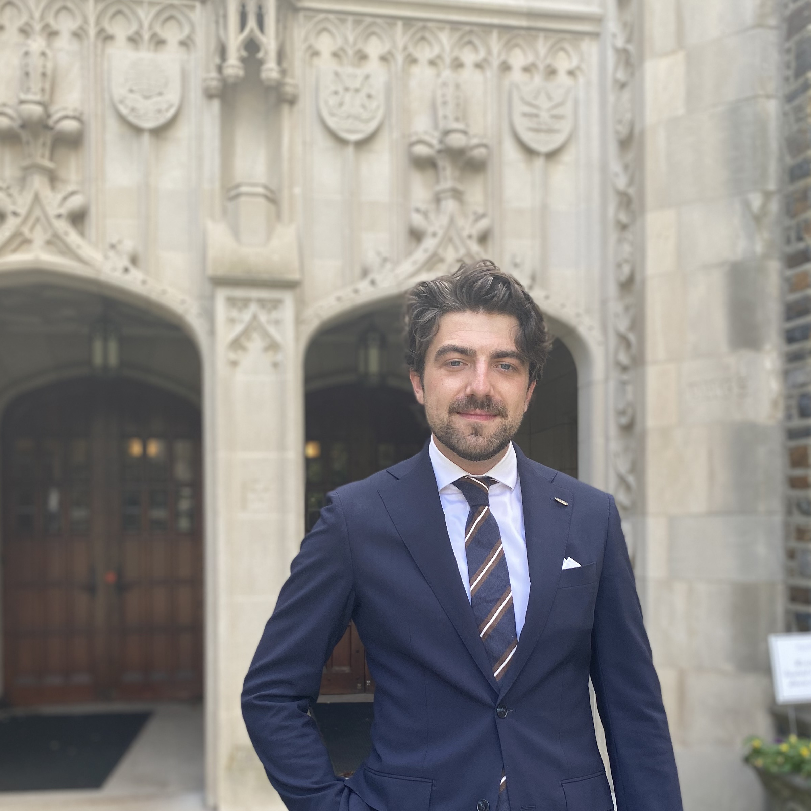

  

    
    
Dirck de Kleer

  

  

    
I'm a PhD Candidate in Social and Political Science at <a href="https://www.unibocconi.it/en/programs/phd/phd-social-and-political-science">Bocconi University</a> in Milan. During the 2023/24 academic year, I was a visiting PhD student at <a href="https://icea.spia.princeton.edu/">Princeton University</a> and the <a href="https://www.lse.ac.uk/government">London School of Economics</a>. 

    
 My research focuses on political behavior and public opinion in Western Europe, and sometimes beyond. Most of my current work examines the consequences of far-right parties' and politicians' increased visibility and success. For example: I show that it increases prejudiced behavior and leads to losses in parliamentary decorum. 

    
 In other work, I meta-analyze experimental evidence on the effects of elite cues and study changing party electorates in Western Europe. I am also interested in compiling unconventional data sets that increase our understanding of political behavior. For example: I have assembled a new dataset with close to 800,000 speeches from parliamentary committee debates in the Netherlands (forthcoming). My research has been published in the <a href="https://www.cambridge.org/core/journals/british-journal-of-political-science">British Journal of Political Science</a>.

  

